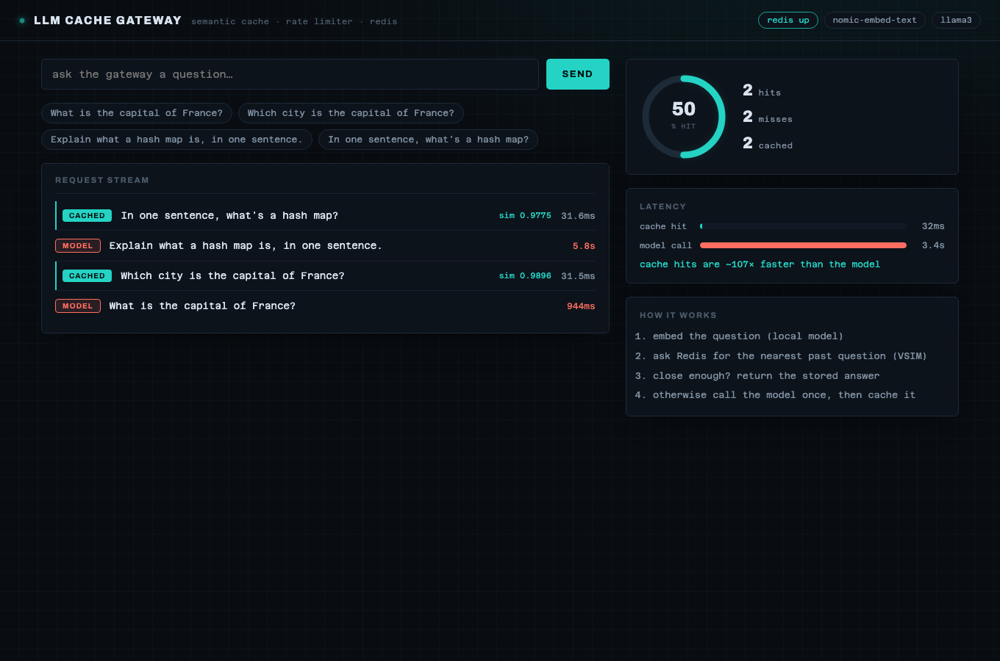

# LLM Cache Gateway

A caching gateway that sits in front of a local LLM. Before a question reaches
the model, it checks a Redis semantic cache: if the same thing (or a reworded
version) was asked before, the stored answer comes back in milliseconds and the
model is never called. Each client is also rate limited in Redis.

In a quick batch of reworded questions, cache hits came back in about **30 ms**
versus roughly **12 s** for a model call, so a hit is a few hundred times faster.



## Redis is doing the real work

- **Semantic cache** uses the Redis 8 **Vector Set** type. Each question is
  embedded once (locally) and added with `VADD`. A new question is matched
  against the set with `VSIM`, and if the nearest past question is close enough,
  its answer is returned straight from Redis. No second model call.
- **Rate limiting** is a sliding window done atomically in one Lua script per
  request: drop old timestamps, count what's left, and only admit the request if
  the client is under the limit.
- Redis also holds the cached answers (hashes) and the hit/miss counters.

Everything local and open: [Ollama](https://ollama.com) runs
`nomic-embed-text` for the embeddings and `llama3` for the answers.

## Layout

```
backend/
  store.py       the semantic cache (Redis Vector Set) + stats
  ratelimit.py   sliding-window limiter (atomic Lua)
  models.py      local embed + answer via Ollama
  main.py        the gateway: rate-limit -> cache -> model
  bench/         shows the latency the cache saves
  tests/         pytest suite
frontend/        Vite + React telemetry console
```

## Running it

Needs Redis 8+ (for the Vector Set type) and Ollama:

```bash
brew install redis && redis-server            # Redis 8 ships VADD/VSIM
ollama pull nomic-embed-text && ollama pull llama3

cd backend
pip install -r requirements.txt
uvicorn main:app --port 8000
```

Frontend:

```bash
cd frontend
npm install
npm run dev        # http://localhost:5173
```

Ask a question, then ask it again in different words, and watch the second one
come back as a cache hit. Add `?demo` to the URL to see a finished console state
without anything running.

## Tests

```bash
cd backend
pytest -q                       # cache logic + rate limiter against local Redis
GATEWAY_RUN_LIVE=1 pytest -q     # also the live embed + model path
```

The cache tests use hand-made vectors so they don't need a model, just Redis on
db 15 (they flush it).

## See the payoff

```bash
cd backend
python bench/benchmark.py
```

It sends a batch where many questions are rewordings of each other and reports
the hit rate, the average hit vs model latency, and the wall-clock time saved.

## Tuning

- `CACHE_SIM_THRESHOLD` (default 0.93) how close a match has to be to count.
- `RATE_LIMIT` / `RATE_WINDOW_S` requests allowed per window.
- `EMBED_MODEL` / `ANSWER_MODEL` swap in other local models.
